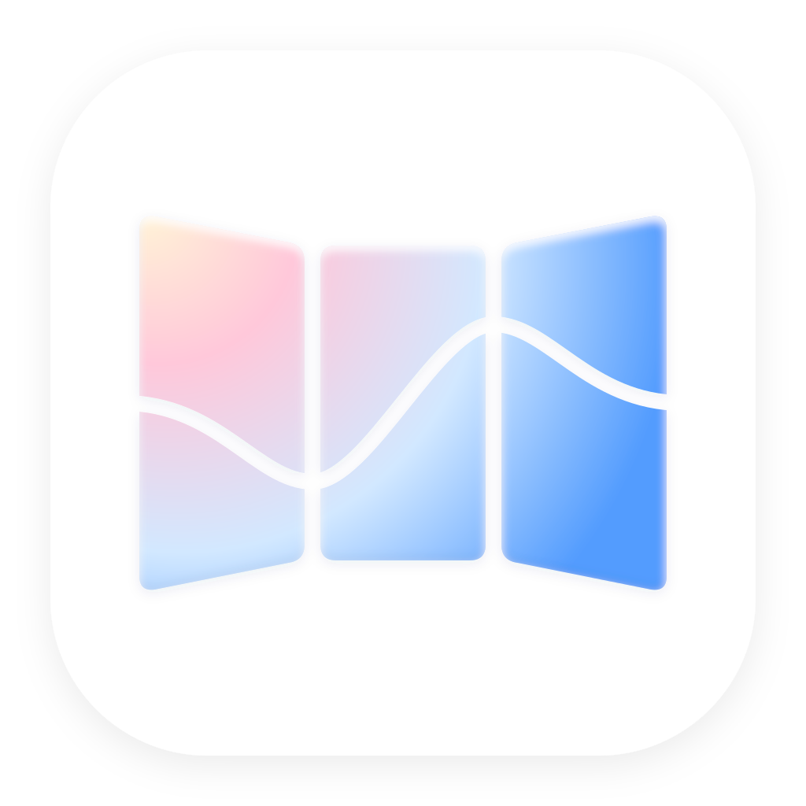
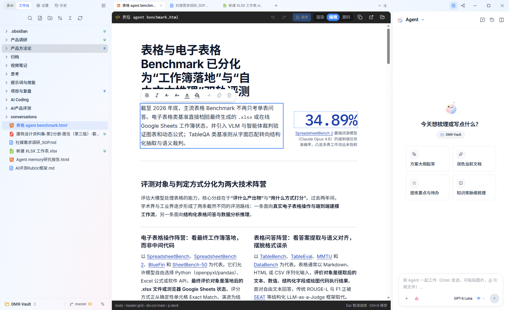
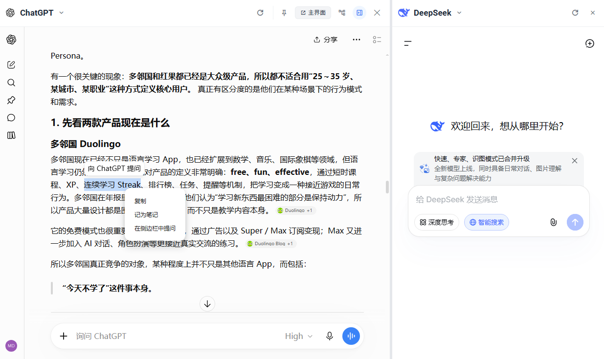
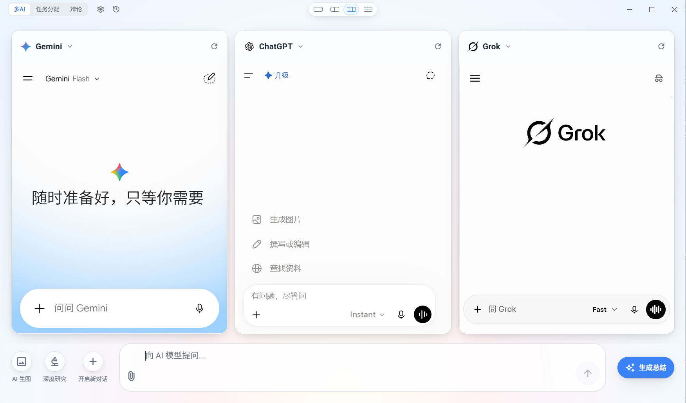
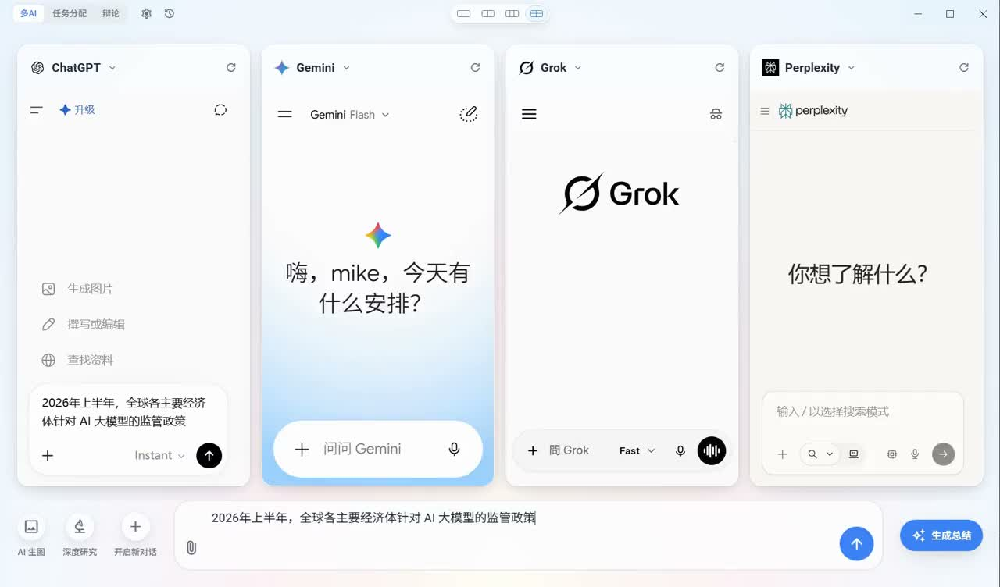
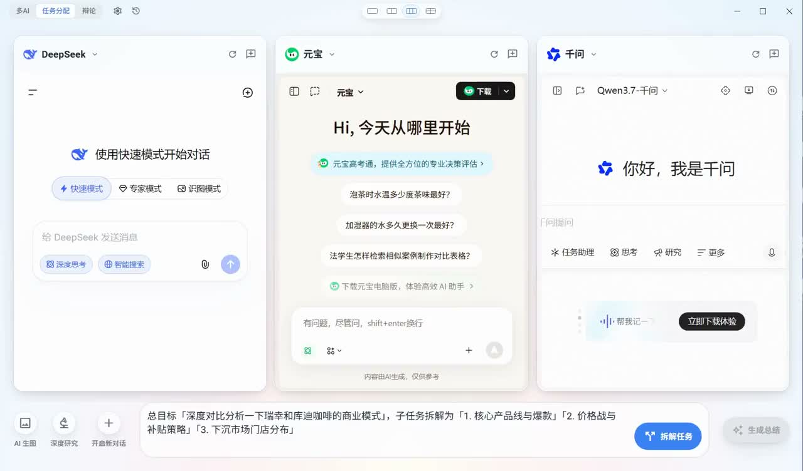
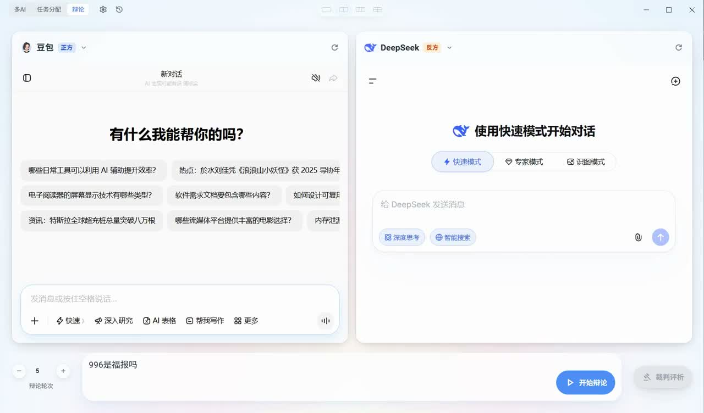

<table width="100%" border="0" cellpadding="0" cellspacing="0">
  <tr>
    <td align="left" valign="middle" width="80">
      
    </td>
    <td align="left" valign="middle">
      <div><strong><big>MultiChat Desk</big></strong></div>
    </td>
    <td align="right" valign="middle">
      <a href="#product">产品简介</a> ·
      <a href="#workbench">工作台</a> ·
      <a href="#quick-window">快捷窗口</a> ·
      <a href="#workflows">并行工作流</a> ·
      <a href="#notes-mindmap">笔记与导图</a> ·
      <a href="#cli">CLI</a> ·
      <a href="#download">下载</a> ·
      <a href="#developer">开发</a>
    </td>
  </tr>
</table>

<hr />

<div align="center">
  <p><strong>多个 AI 并行思考，随时唤起、划词追问，把好答案留成笔记与导图。</strong></p>
  <p>主窗口处理复杂任务，快捷窗口陪伴日常阅读：从提问、对比到批注与整理，在同一个桌面工具里完成。</p>
  <p>
    <a href="https://github.com/max-doo/MultiChat-desk/releases"></a>
    <a href="https://github.com/max-doo/MultiChat-desk/releases"></a>
    <a href="https://github.com/max-doo/MultiChat-desk/blob/main/LICENSE"></a>
    <a href="https://www.electronjs.org/"></a>
  </p>
</div>

<p align="center">
  
</p>

> MultiChat Desk 是面向 AI 重度用户的桌面工作区，直接承载各 AI 平台的网页体验。你可以在主窗口同时询问多个 AI，也可以随时唤起快捷窗口，在阅读中追问，再把值得保留的内容整理为本地笔记和思维导图。

<a id="product"></a>
## ✨ 产品简介

### 按当前任务，选择合适的入口

| 你正在做什么 | 推荐入口 | 可以怎样使用 |
| --- | --- | --- |
| 写作沉淀、管理知识库、让 AI 直接动手改文档 | **工作台** | 本地 Markdown 知识库配富文本编辑，AI 网页与本地 Agent 在侧边协同创作 |
| 随手提问、读长回答、处理桌面选中文字 | **快捷窗口** | 快捷键唤起，划词带入问题，在侧边栏向另一个 AI 追问 |
| 比较答案、并行调研、推敲方案 | **主窗口** | 多 AI 同题对比、拆分任务分发、正反方辩论，再汇总结果 |
| 保留关键段落、复习长对话、整理观点 | **笔记与思维导图** | 划词标注与摘录直接写进工作台文档，对话可整段落库，再生成导图梳理结构 |

例如，做一次产品方案研究：先在主窗口让多个 AI 提供不同视角，把值得保留的回答整理进工作台文档；之后在快捷窗口或工作台里继续精读、批注和追问，最终在工作台里写出成稿，必要时让本地 Agent 直接动手修改和生成文件。

<a id="workbench"></a>
## 📂 工作台：本地知识库与 AI 协同创作空间

多 AI 对话产出内容之后，整理与写作在工作台完成。任选本地文件夹作为工作区，资料以标准 Markdown 形式存储，YAML Frontmatter 无损保留，与 Obsidian 库完全兼容。

<p align="center">
  
</p>

*左侧为工作区文件树（带 Git 状态标记），中间正在可视化编辑一篇 HTML 调研报告，右侧本地 Agent 已就绪，可直接在库内读写文件。*

### 写作、预览与管理集中在一处

- **富文本与源码双模式**：基于 Meta Lexical 的所见即所得 Markdown 编辑，即时语法转换、自动保存，可随时切到源码；`.html` 文档支持渲染、可视化编辑与源码三种模式。
- **多格式文件预览**：PDF 带可选中文本层与缩放，Word / Excel / PPT / CSV 均可内嵌预览，代码文件高亮展示，不支持的类型一键用系统应用打开。
- **文件树完整管理**：新建、重命名、多选、拖拽移动、复制粘贴与回收站；工作区接入 Git 时，文件树直接显示改动状态，并可查看提交历史图。
- **会话资料落库**：划词「标注」「摘录为文档」直接把内容写进工作区，整段会话随之自动保存为带 Frontmatter 来源信息的 Markdown 文档；笔记可绑定思维导图，持续编辑演进。

### 两种 AI 协同方式

- **AI 网页侧边栏**：复用已登录的平台会话，划词即可提问、解释、润色；文件树节点与预览中的文件可一键发给 AI，AI 回复可插入当前笔记或另存为新文档，AI 网页内生成的图片等产物自动保存进工作区。
- **本地 Agent 助手**：在侧边栏直接读写工作区文件、执行脚本任务，支持多供应商模型切换与三档权限模式；配有大纲起草、文档润色等快捷指令与随包技能，可生成 XLSX 等真实产物。

<a id="quick-window"></a>
## ⚡ 快捷窗口：随时唤起的 AI 阅读与追问入口

日常使用 AI，常常从一个小问题或一段正在阅读的文字开始。快捷窗口提供独立的轻量入口，支持置顶、切换平台和展开侧边栏，让阅读与追问并排进行。

<p align="center">
  
</p>

*左侧保留 ChatGPT 原对话，右侧打开 DeepSeek。选中文字后，右键菜单可将它「标注」「摘录为文档」或带入「在侧边栏中提问」；截图展示的是追问前的阅读与选区操作。*

### 阅读时，随手向另一个 AI 追问

1. 在快捷窗口中阅读当前 AI 的回答，展开侧边栏并选择用于追问的平台。
2. 选中需要解释、核对或进一步展开的文字，右键选择 **在侧边栏中提问**。
3. 选区会填入侧边栏当前平台的输入框，你可以补充要求后手动发送。
4. 继续保留左侧原文，对照右侧的新回答；重要段落可右键 **标注** 或 **摘录为文档**，收进工作区（若当前对话已有思维导图，还可直接 **加入当前导图**）。

侧边栏可自由拖拽调整宽度，也可随时收起；快捷窗口在未置顶固定时点击窗口外部即可自动收起。快捷窗口和主窗口的单列布局都提供侧边栏提问与思维导图入口。

### 从桌面选区进入 AI 对话

- **全局唤起**：默认按 `Ctrl+Shift+Space` 打开或隐藏快捷窗口；macOS 对应 `Cmd+Shift+Space`。可置顶使用，也可从窗口顶部进入主界面。
- **划词工具条**：在支持读取选区的应用中选中文字，通过「问问」「搜索」「总结」「翻译」「复制」处理；可在设置或托盘菜单中开关。
- **自定义快捷动作**：可为总结、润色、翻译、纯文本入框和搜索分别配置快捷键；除唤起快捷键外，这些动作默认未绑定。
- **快速切换 AI**：在窗口顶部切换平台，切换时尝试携带尚未发送的输入文本。

外部应用选区的读取取决于操作系统、应用支持和权限；Windows 是当前主要验证平台，macOS 的划词工具条需要辅助功能权限。

<a id="workflows"></a>
## 🎯 主窗口：多 AI 并行处理复杂任务

需要比较观点或组织分工时，主窗口提供统一输入和多个并排的 AI 网页窗口：先填写问题并确认，让文字进入各平台输入框，再点击发送统一触发回答。确认发送前可以取消并清空已填入的内容。

<p align="center">
  
</p>

### 三种并行工作流

| 多 AI 模式 · 横向对比 | 任务分配模式 · 智能拆解 | 辩论模式 · 全自动对抗 |
| --- | --- | --- |
|  |  |  |
| 同一问题同时发给多个 AI，回答并排出现，适合对比质量、验证事实、获得多角度意见。 | 输入总目标，AI 自动拆解成子任务，按窗口分配、可编辑，再一键发送。 | 两个窗口作为正反方轮流发言，完成多轮攻防后交给裁判总结。 |

### 多 AI 模式

- 支持单列、双列、三列、四窗布局。
- 统一输入，一次发送到当前显示的多个平台。
- 每个 Webview 独立运行，方便保留不同平台的原生能力和上下文。
- 可批量开启支持平台的 Deep Research 或 AI 生图模式。

### 任务分配模式

- 使用已配置的 API 模型拆解总目标；自动拆解需要先配置可用的供应商和模型。
- 子任务支持编辑、增删和切换指派窗口。
- 按窗口槽位分发，适合资料搜集、方案比较、分工调研等并行任务。
- 完成后可进入“成稿汇总”流程，把多个子任务结果合成可交付内容。

### 辩论模式

- 两个窗口分别承担正方和反方。
- 支持 1–10 轮辩论，自动推进立论、交锋和结辩流程。
- 自动引用上一轮发言并轮流发送，减少手动协调。
- 辩论结束后由“辩论裁决”总结按轮次追踪攻防、评分并给出裁决。

<a id="summary"></a>
### 把多个回答整理为结论

在总结页选中需要参与分析的回答，选择总结平台、预设并补充要求。应用会把整理后的内容和提示词填入该平台的网页输入框，长内容会以 Markdown 附件上传；若填入后想微调要求，可一键撤回提示词并保留草稿（再次填入时无需重复上传附件），检查无误后**在平台网页内手动确认发送**，再继续追问。

总结复用已登录的 AI 网页，无需额外配置总结 API Key。

| 内置总结预设 | 适合场景 |
| --- | --- |
| **综合最佳** | 多模型去重、互补和纠错，输出更完整的综合答案 |
| **裁判找茬** | 查找事实错误、逻辑漏洞和不可靠表述 |
| **辩论裁决** | 分析辩论攻防、评分并给出最终裁决 |
| **成稿汇总** | 将任务分配模式的多个子任务结果合成为成稿 |

可在 **设置 → 任务分配与总结设置** 中管理自定义总结提示词。该处的 API 供应商和模型配置用于**任务分配的自动拆解**：新增供应商，填写其 OpenAI 兼容 Base URL 与 API Key，验证并添加或同步模型后，在任务拆解弹窗中选择使用。

<a id="notes-mindmap"></a>
## 📝 笔记与思维导图：把好答案沉淀进工作区

长对话中真正有价值的内容，往往是几段关键解释或一组相互关联的观点。笔记与导图能力已经深度整合进工作台：标注、摘录和整段会话都会以标准 Markdown 落在工作区里，思维导图同样是工作区中的文件，不再依赖独立页面或私有格式。

### 划词标注、摘录与会话落库

阅读 AI 回答时选中文字，右键菜单提供两种动作：

- **标注**：在原文上留下高亮和评论。高亮同时出现在原对话网页与对应的会话文档中，正文改写后仍能重新定位；在工作台打开文档时，标注以页边批注形式并排展示，可跳回侧边栏的原会话，也可以把批注导出为脚注式 Markdown。
- **摘录为文档**：把选中的内容带走，变成一篇可独立编辑的 Markdown 文档，不再依赖原文。

创建标注或摘录时，整段会话会自动保存为带 Frontmatter 来源信息的 Markdown 文档：工作台内捕捉进当前工作区，工作台外捕捉进默认会话库（文档目录下的 `MultiChat Vault`）。所有内容最终都是本地文件，可直接用 Obsidian、VS Code 等外部工具继续编辑。

本地快照保存的是采集时可读取的对话内容；网页尚未加载的旧消息、图片等非文本内容可能无法完整保留。

### 思维导图：从对话或文档生成，落为工作区文件

两个入口都能生成导图：阅读对话时在快捷窗口或主窗口单列布局打开思维导图侧边栏；在工作台中则可以基于当前打开的 Markdown、代码等文档直接生成。工作台导图以 `.mindmap.md` 文件保存在工作区 `.multichat/mindmaps` 目录，绑定关系随文件夹搬迁自动保持，也可以直接用 XMind、幕布等外部软件打开编辑。

1. **一键提炼导图**：选择用于生成的 AI 平台，可补充「重点整理核心论点」「保留不同方案的分歧」等要求，点击 **生成导图** 即可将当前对话或文档提炼为结构化思维导图。
2. **自然语言持续修改**：对生成的导图不满意或有新想法时，直接在底部输入框提出修改要求（无论是局部增删分支，还是整张导图重构），预览变化后一键应用或随时撤回；阅读对话或文档时选中文字右键 **加入当前导图**，可把新内容并入。
3. **画布深度编辑与大纲同步**：支持在画布上双击编辑文字、设置节点**加粗**与==高亮==、鼠标框选批量操作、拖拽分支调整层级与顺序；也可随时切换到 Markdown 大纲编辑器实时同步修改，同一文档可管理多张导图。
4. **高清导出**：按需导出为高清 PNG 图片、矢量 SVG 或 Markdown 大纲。

也可以 **新建空白导图** 自行梳理观点；如需使用在线幕布，可在导图顶部「更多」菜单中一键切换。

<a id="capabilities"></a>
## 🧩 平台与其他能力

### 支持的 AI 网页平台

内置 13 个平台：ChatGPT、Claude、Gemini、Grok、Perplexity、DeepSeek、千问、Kimi、豆包、元宝、智谱清言、文心一言、Arena。

各平台保留自己的原生网页能力和账户权限，登录状态可跨应用内窗口复用。MultiChat Desk 提供统一布局、输入、发送和内容整理；平台会员、网络连通性与网页改版会影响实际可用性。

你可以在 **设置 → 模型排序** 中通过拖拽自由调整各平台在下拉列表中的显示顺序，把最常用的 AI 放在最顺手的位置；每个网页窗口均支持独立的 **页面内查找（`Ctrl+F` / `Cmd+F`）** 与统一的毛玻璃右键菜单，方便在长回答中快速检索、摘录和追问。

这些已登录的平台会话也可以通过附带的 `multichat` 命令行工具被本地 Agent 调用，见下文 [CLI](#cli)。

### 文件上传与对话历史

- 支持拖拽或粘贴文件到统一输入区域，并尝试同步到当前显示的模型窗口。
- 可处理图片、PDF、TXT、DOCX、Markdown、CSV、XLSX 与代码文件；实际可上传的格式和数量以各平台限制为准。
- 对话历史和总结记录采用按会话独立存储，积累上千条长对话依然流畅加载，方便随时恢复之前的任务和平台会话。
- 笔记、快照与导图全部保存在本地；设置面板支持**一键导出与导入完整本地数据**（涵盖对话历史、总结记录、笔记、思维导图与个性化配置），方便日常备份与换机迁移。使用 AI 总结、导图生成或任务自动拆解时，相关内容会发送到你选择的网页平台或 API 供应商。

### Deep Research 与 AI 生图

工具栏提供统一入口，按当前平台的选择器配置尝试开启深度研究或 AI 生图模式；不同平台支持范围不同，未配置的平台会明确提示不支持。AI 生图结果还支持检测和批量下载流程。

<a id="cli"></a>
## 🤖 CLI：让本地 Agent 调用全网 AI

除了在窗口里手动操作，MultiChat Desk 附带一个 `multichat` 命令行工具，把应用里已登录的 13 个平台会话开放给本地 Agent 与脚本：无需 API Key，一条命令把提示词发给指定平台，拿回完整 Markdown 回复、生成的图片或深度研究报告——适合让 Codex、Claude Code 等编码助手把方案评审、深度调研、第二意见分发到任意网页 AI。

```bash
# 问一个平台，等待并拿回回复
multichat task submit --platform gemini --query "评审这个接口设计" --wait 600

# 让平台生成图片并保存到本地（回复与图片落盘到 ./.multichat/）
multichat task submit --platform gemini --gen-image --query "生成一只窗边晒太阳的橘猫"

# 探测各平台支持的能力：深度研究 / 生图 / 追问
multichat platforms
```

任务提交即返回 ID，同平台自动排队、跨平台并行；支持深度研究开关、图片附件、会话内追问、长轮询与随时取消。Windows 安装器提供「加入 PATH」选项，设置面板可查看状态并一键补挂；内置 `multichat-cli` Skill 随包分发，Agent 安装后即可直接调用。

<a id="download"></a>
## 🚀 下载与首次使用

### 下载

- **Windows**：前往 [GitHub Releases](https://github.com/max-doo/MultiChat-desk/releases) 下载安装版或便携版。
- **macOS**：同一 Release 页提供 dmg 安装包——文件名含 `arm64` 的适用于 Apple 芯片（M 系列），无后缀的适用于 Intel 芯片。安装包未做 Apple 签名与公证，首次打开请右键 → 打开（详见包内 `FIRST_OPEN_ON_MACOS.md`）。
- **Linux**：仓库提供 `pnpm run build:linux` 构建脚本，暂无正式发布物。
- **产品介绍**：访问 [MultiChat Desk 落地页](https://multichat.top)。

本文按当前仓库源码介绍功能；下载的发布包可能尚未包含最新源码改动，请结合 [变更日志](CHANGELOG.md) 和对应 Release 说明查看。

### 首次启动

1. 启动后，在需要使用的平台窗口中分别完成登录。
2. 按 `Ctrl+Shift+Space` 试用快捷窗口：选择常用 AI，阅读回答后选中文字，尝试「在侧边栏中提问」或右键「标注」。
3. 要并行比较时，进入主界面，选择「多 AI」模式；底部输入后先确认填入，再统一发送。
4. 需要汇总时，进入总结页，选择回答、平台和预设，填入后在 AI 网页内手动发送；自动拆解任务则需先在设置中配置 API 供应商和模型。
5. 打开工作台回看标注、会话文档与导图；也可以从对话或文档生成新的思维导图，再继续编辑或导出。
6. 想把 AI 接入脚本或编码助手时，在设置面板「命令行与 Agent 集成」确认 `multichat` 已加入 PATH，然后运行 `multichat task submit --platform <id> --query "..."` 即可。


<a id="developer"></a>
## 🛠️ 开发与构建

### 技术栈

- Electron 42、React 18、TypeScript、Zustand
- Tailwind CSS、electron-vite、electron-builder
- 主进程负责窗口、Session、IPC、持久化与自动化服务；渲染进程负责界面、状态和 Webview 交互；preload 只暴露安全桥接。

### 环境要求

- Node.js 20.x 或更高版本
- pnpm 10.x 或更高版本
- 网络连接；部分 AI 平台可能需要代理
- Windows 与 macOS 是当前开发和发布验证平台；Linux 仅提供构建脚本，未做发布验证

项目只使用 pnpm，不使用 npm、yarn 或其他包管理器。

### 安装与开发

```bash
git clone https://github.com/max-doo/MultiChat-desk.git
cd MultiChat-desk
pnpm install
pnpm run dev
```

### 检查与构建

```bash
# 静态检查
pnpm run lint

# 构建 main / preload / renderer / CLI
pnpm run build

# Windows 安装版与便携版
pnpm run build:win:nsis
pnpm run build:win:portable
pnpm run build:win:all

# 在对应操作系统上构建
pnpm run build:mac
pnpm run build:linux
```

构建产物位于 `out/` 或 `dist/`。这两个目录是生成目录，不要手工修改。

### 项目结构

```text
src/
├── main/       # Electron 主进程：窗口、Session、IPC、持久化与自动化服务
├── preload/    # 安全桥接与 IPC 类型契约
├── renderer/   # React 页面、状态、组件与 Webview 交互
├── shared/     # 主进程与渲染进程共享的选择器和工具
└── cli/        # CLI 与 daemon 相关入口
docs/           # 用户、构建、配置和设计文档
assets/         # 应用资源
```

第三方 AI 平台的 DOM 选择器集中维护在 [`src/shared/config/selectors.ts`](src/shared/config/selectors.ts)，注入脚本集中在 `src/shared/utils/` 与 `src/renderer/src/utils/`。调整平台自动化前，建议先阅读 [选择器维护方法论](docs/选择器维护方法论.md)。

<a id="faq"></a>
## ❓ 常见问题

### 为什么某个平台显示空白或无法发送？

先检查网络、代理和平台登录状态，再尝试刷新该窗口。第三方平台频繁改版时，也可能需要更新选择器；开发态可使用诊断页面定位输入框、发送按钮和回复容器。

### 为什么总结按钮不可用？

先确认已有可读取的回答，并在总结页选择参与分析的内容和可用的平台。任务分配的「成稿汇总」和辩论的「辩论裁决」需要相应工作流的结果；提示词填入后，还需在平台网页内手动发送。

### 普通使用需要 API Key 吗？

多 AI 同题发送、快捷窗口、笔记、网页总结和通过网页生成导图都使用平台网页账户。任务分配的自动拆解需要另行配置 API Key、兼容的 Base URL 和模型；其 API 使用费用由对应供应商决定。

### 登录信息和历史记录保存在哪里？

数据默认由 Electron 应用在本地持久化。安装版和便携版的存储位置不同，具体可参考 [用户使用指南](docs/USER_GUIDE.md) 和 [便携版构建指南](docs/PORTABLE_BUILD_GUIDE.md)。不要把包含 Cookie、API Key、历史内容的配置文件提交到 Git。

### 如何重置开发态配置？

```bash
pnpm run clean:store
```

该命令清理应用及开发态目录下的 `config.json` / `config-dev.json`；执行前请确认不需要保留其中的设置、历史记录和 API 配置。

### 修改平台选择器后如何验证？

先运行 `pnpm run lint` 和 `pnpm run build`，再用 `pnpm run dev` 在真实桌面窗口中登录并触发对应平台的发送、收集、总结或上传流程。静态检查不能替代 Webview、焦点、鼠标和平台网页的实际验收。

<a id="links"></a>
## 🔗 项目链接

- [GitHub 仓库](https://github.com/max-doo/MultiChat-desk)
- [Releases 下载](https://github.com/max-doo/MultiChat-desk/releases)
- [Issues](https://github.com/max-doo/MultiChat-desk/issues)
- [Discussions](https://github.com/max-doo/MultiChat-desk/discussions)
- [产品落地页项目](https://github.com/max-doo/MultiChat-LP)

## 📄 许可证

本项目采用 [Apache License 2.0](LICENSE) 开源。

欢迎提交 Issue、完善平台选择器、改进文档或贡献代码。提交前请确保没有包含 API Key、Cookie、Token、私有密钥或真实用户数据。
